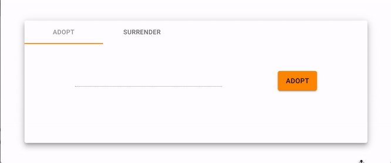
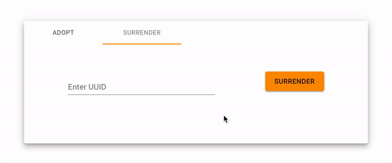

# UUID Farm

UUID Farm is a place for UUIDs to get a second chance at life. Surrender an identifier
you no longer need, or adopt one that’s waiting for a home. The UUIDs really are stored
in a database and passed along to whoever adopts them next.

I started this project as a joke because, obviously, these unique identifiers are not
intended to be reused. I built it as though it was real using Firestore as a database
and an OpenAPI spec as if others would potentially use this server as a service. I
ended up contributing improvements to OpenAPI Generator during Hacktoberfest.

I revisited the project with AI assistance to give the farm a new look and add little
UUID inchworms you can pick up and move around.

## Life on the farm

The browser presents a layered, illustrated farm. Sun, clouds, mountains, meadow, barn, oak, and
foreground fence arrive in sequence. The fence remains an independent visual and landing
surface. After an adoption, the reception desk displays a paper record with the returned
UUID, name, version, intake/adoption dates, and any legacy tag, plus a copy button.
“Their story so far” appears on the paper when earlier visits are recorded, beyond
the current arrival and adoption shown above. Open it to see recorded arrivals and
adoptions, most recent first, with earlier chapters available a page at a time. A
resident who has been adopted can return through the same surrender form and find another home.
Returning residents keep their name and intake note.
Painted clouds drift slowly across the sky, wrapping offscreen; the wind chooses left or
right on each page load.

“Barnyard Groove” defaults to on and loops quietly on the page, with a music button
beside the open sign. Browsers that block autoplay wait for an interaction; the toggle
stays on while waiting, and tapping it turns music off immediately. Turning it off is
remembered on this browser. The original recording is kept
in `assets/audio/barnyard-groove-source.m4a`; the browser AAC copy lives in
`ui/public/audio/barnyard-groove.m4a`.

UUID residents inch along the fence and the top of the reception card. Their four hyphens
act as hinges between five rigid character groups: one end stays planted while the body
arches, then the other end anchors as it stretches forward. Each resident has its own
pace and randomly timed bouts of inching, looking around, sniffing, stretching, and resting,
with independent blinks. Pick one up to
let it dangle, then release above the card or fence to let it settle. Dropping below the
fence lets it fall out of view. These interactions never change Firestore records.
Keyboard users can focus a creature, press Enter/Space to pick it up, move with arrow
keys (Shift for larger steps), press Enter/Space to drop, or Escape to return it.

Each page load creates four fresh decorative UUIDs in the browser. The scene does not
fetch residents or synchronize its creatures with adoption and surrender records.
Actual adoption and surrender always require a successful API response. Animation pauses
when the tab is hidden, and OS reduced-motion preferences keep the scene still.

Artwork lives in `ui/public/art/`; generation prompts and provenance are in
[assets/art-direction.md](assets/art-direction.md). Browser tests mock the API so they can
exercise adoption, surrender, offline behavior, accessibility, and dragging without changing data:

```sh
cd ui
npx playwright install chromium
npm run test:e2e
# Or use an existing Chrome installation:
PLAYWRIGHT_CHROME=1 npm run test:e2e
```

## Architecture and API workflow

The server separates application setup, HTTP adapters, domain models, and storage:

- `cmd/server`: executable entrypoint.
- `internal/app`: configuration, dependency wiring, HTTP lifecycle, static hosting.
- `internal/api`: hand-written HTTP adapters and contract tests.
- `internal/farm`: shared resident models, identity normalization, domain errors.
- `internal/store`: Firestore transactions and queries; no HTTP dependencies.
- `api`: embedded OpenAPI document and its loader.

Published modules from [pkg](https://github.com/Jesse0Michael/pkg) provide configuration
(`config.New`), structured logging (`logger.NewLogger`), HTTP server construction
(`http/server.New`), and JSON encoding (`http/server.Encode`). Versions are pinned in
`go.mod`; sibling checkouts and local replace directives are not required.

OpenAPI is authoritative: edit `api/openapi.yaml` first. The server registers handlers
by the spec's operation IDs and reads pagination bounds/defaults and name length from
its schemas. Startup rejects missing or extra operation implementations. Contract tests
exercise every declared operation and validate success/error responses against the spec.
`make gen` produces browser types and docs; it does not generate Go application code.
Firestore models stay separate so API edits cannot silently change persisted field names.

Technology decisions:

- **Keep the web frontend.** [Wails](https://wails.io/) is useful for native applications
  with Go bindings, windows, menus, and desktop integration. UUID Farm only needs a hosted
  browser UI. Adding that runtime would not improve the existing workflow.
- **Keep native Firestore queries.** [Ent's supported dialects](https://entgo.io/docs/dialects/)
  do not include Firestore. Adopting Ent would require replacing the database or maintaining
  a custom storage driver, with no benefit for the current entity model.
- **Use helpers selectively.** `pkg/config`'s Firestore constructor creates a low-level
  API-key client; this service needs the high-level transactional client with ADC/emulator
  support. `boot.App` adds its own metrics listener and lifecycle semantics, so shutdown
  remains explicit. `pkg/http/errors` has a different public JSON envelope; existing
  `{code, message}` responses are preserved. Strict metadata decoding also remains local.
- **Dependency tradeoff.** `pkg/config` includes SQL, Redis, and telemetry helpers in one
  Go package. Its transitive dependency footprint is larger than a standalone env parser.
  We accept that cost for consistency with the shared toolbox, without enabling those
  services. OpenTelemetry adapters are aligned with Firestore's selected logging API.

## Run everything with Docker Compose

Only Docker with Compose v2 is needed; Go, Node, Java, and Google credentials are not
needed on your host.

```sh
make up                 # build and start the app and Firestore; wait for health checks
make seed COUNT=100     # surrender 100 new UUIDv4 residents through the local API
make logs               # follow app and emulator logs
make down               # stop and remove the local stack
```

Open http://localhost:8080. Compose uses Google's Cloud CLI `emulators` image and the
`demo-uuid-farm` project. The app is explicitly connected to `firestore:8787` and does not
use production credentials. Host access to both services is bound to loopback.
The emulator is in-memory: stopping/restarting it clears local residents. `make up` never
seeds automatically; repeat `make seed` when you want more residents (default count: 25).

To avoid port conflicts, use `APP_PORT=8088 FIRESTORE_PORT=8788 make up`.
These change host ports only; Compose seeding continues to use the internal app address.
The equivalent seed command is `docker compose run --build --rm seed 100`.

### Seed any running server

`cmd/seed` uses `google/uuid.NewRandom` (cryptographically random UUIDv4) and the existing
surrender endpoint. It does not write directly to Firestore. Build it independently:

```sh
make build-seed
./bin/seed 100
./bin/seed -url https://your-deployed-server.example 100
```

The URL is the server base URL **without `/v1`**. Flags go before the integer count.
The default target is `http://localhost:8080`. The command waits up to 30 seconds for
`/health`; change that with `-wait 60s`. A count of zero checks readiness without writing
(and is also used by Compose's app health check). Negative counts are rejected.

To run the standalone seed container against a deployed server:

```sh
docker build --target seed -t uuid-farm-seed .
docker run --rm uuid-farm-seed -url https://your-deployed-server.example 100
```

Requests are sequential and have a 10-second timeout. The command stops on the first
failure and reports the confirmed count. It does not retry failed writes or follow
redirects; a lost response can mean the last UUID was accepted despite a reported error.
A later run creates fresh UUIDs. No production seeding runs during builds, tests, or startup.

## Development with host tools

Requires Go 1.27+, Node 24+, and npm. No npm registry token is needed.

```sh
cd ui
npm ci
npm start
```

In another terminal, start the API using a **local Firestore emulator**:

```sh
gcloud emulators firestore start --host-port=127.0.0.1:8787
# In a separate terminal:
export FIRESTORE_EMULATOR_HOST=127.0.0.1:8787
export GOOGLE_CLOUD_PROJECT=demo-uuid-farm
make run
```

Open the Vite URL (normally http://localhost:5173). It proxies `/v1` to the Go server
on port 8080. Emulator data is disposable. Tests use a separate demo project.

For a real Firestore project, unset `FIRESTORE_EMULATOR_HOST`, set
`GOOGLE_CLOUD_PROJECT`, and use Application Default Credentials, for example
`gcloud auth application-default login`. A mounted service-account file through
`GOOGLE_APPLICATION_CREDENTIALS` also works. The old `GOOGLE_CREDENTIALS` mechanism
that wrote secrets to disk has been removed.

## Build and checks

```sh
make ui             # install UI dependencies and build ui/dist
make build          # build bin/uuid-server
./bin/uuid-server   # serve API and ui/dist together on port 8080
make test           # Go race tests, frontend tests/build, API lint
make gen            # regenerate local TS API types and standalone ReDoc docs
make build-docker   # build the combined application image
```

`PORT`, `UI_DIR` (default `ui/dist`), and `GOOGLE_CLOUD_PROJECT` (default `uuid-farm`)
configure the server. Logging uses `LOG_LEVEL`, `LOG_FORMAT`, `LOG_OUTPUT`, and
`LOG_SOURCE` from `pkg/logger`. `/health` is a process health check, not a Firestore readiness
probe. For production, prefer an explicitly configured project and platform-provided
Google credentials. The container runs as a non-root user.

Run database tests against the emulator:

```sh
FIRESTORE_EMULATOR_HOST=127.0.0.1:8787 go test -race ./...
```

Without that variable, integration tests skip; HTTP and date compatibility tests still
run. Tests exercise repeat surrender/adoption, lifecycle history, duplicate surrender, concurrent adoption, pagination, counters,
legacy timestamps, metadata validation, and canceled requests. They never intentionally
connect to production Firestore.

## Browser analytics

UUID Farm uses a dedicated Google Analytics 4 web stream to measure how often
visitors use the adoption and surrender desks and where requests fail. The
production build loads Google's tag only on the hostname configured through
`ANALYTICS_HOSTNAME`, using the stream's public `GA_MEASUREMENT_ID`. Both
settings come from Terraform at runtime. Local development defaults to analytics off.

| Event | When it fires | Reporting fields |
| --- | --- | --- |
| `screen_opened` | A visitor enters a desk or the API guide, including the first screen | `screen_name` (adopt, surrender, documentation) |
| `service_requested` | A visitor submits a desk form | `service` (adopt, surrender) |
| `adoption_completed`, `surrender_completed` | The API returns a successful result to the browser | Each completion counts as one GA4 key event |
| `service_failed` | The form submission fails | `service` and `failure_reason` (invalid_uuid, already_available, none_available, unavailable) |
| `uuid_copied` | The browser writes an adopted UUID to the clipboard | Event count only |

In a GA4 funnel exploration, start with `service_requested` filtered to
`service = adopt` and follow it with `adoption_completed`. Use the corresponding
surrender events for the other desk. Break down `service_failed` by failure reason
to distinguish an empty farm from an unavailable service. Browser counts can miss
blocked tags or interrupted visits and exclude direct API and seed traffic.
Firestore history records the actual transitions.

Events omit UUIDs, resident names, form values, and raw errors. The tag receives
the landing page origin and referring origin, with URL paths, queries, and fragments
removed. Automatic form and link tracking, Google Signals, and ad personalization
are disabled. To inspect the event queue locally, run the following command in
`ui/`, use the forms against a local server, then inspect `window.dataLayer` in
the browser console. Debug mode keeps the queue in the browser.

```sh
VITE_ANALYTICS_DEBUG=true VITE_GA_MEASUREMENT_ID=G-TEST000001 npm start
```

Deployment prerequisites and the GA4 Realtime check are in the
[Cloud Run setup guide](docs/deploy.md#enable-analytics-on-an-existing-deployment).

## API and compatibility

`api/openapi.yaml` is the contract. `ui/src/api-types.ts` and `docs/index.html` are
regenerated artifacts. The Go handlers are hand-maintained. The former generated
Node client and npm publishing pipeline have been retired.

The farm's **Documentation** button opens the API reference at `/#docs`, keeping the
scene, sound preference, and reception forms in place. Vite serves the generated
reference at `/reference/index.html` and the source contract at
`/reference/openapi.yaml` in development and includes both in `ui/dist` for the
Go server and Docker image. Run `make gen-docs` after changing the spec, Redocly
options, or the farm theme in `docs/template.hbs`. The generated page embeds its
ReDoc runtime, uses system fonts, and disables ReDoc telemetry.

The API still lives at `/v1` to preserve existing action URLs. This is a breaking
contract revision (introduced in spec version 2.0.0; currently 2.1.0):

- `GET /v1/uuids` now returns `{items, nextCursor?}`. Use `limit` (1–100, default 25)
  and the returned `cursor` to page in document ID order.
- Adoption claims the first available document in document ID order atomically.
  It no longer promises random selection. Two adopters cannot claim the same resident.
- Surrender normalizes UUIDs and returns 201 with a Location header, including when
  an adopted UUID returns. Only a UUID already waiting at the shelter returns 409.
- `GET /v1/uuids/{id}/history` returns `{items, nextCursor?}` with events shaped as
  `{id, type, date}` (`type` is `surrendered` or `adopted`). Events appear newest first
  in lifecycle order; use `limit` (1–100, default 25) and the opaque returned `cursor`.
- `PUT /v1/uuids/{id}` accepts only `{name: string}` (up to 80 characters).
  An empty string clears the name. Dates and other lifecycle fields are server-managed.
  Names remain publicly editable, as in the original; there are no user accounts.
- New dates use RFC3339. Historical Go time strings are normalized when read, without
  rewriting stored timestamps. Historical Firestore field names remain unchanged:
  `Id`, `Name`, `Tag`, `SurrenderDate`, `AdoptionDate`. Availability still means
  `AdoptionDate == ""`. Surrender updates the current intake date and clears the
  current adoption date; adoption sets the current adoption date.
- Every new lifecycle transition appends an event under `uuids/{id}/history` in
  the same transaction as the resident update. This additive history migration
  preserves the root document format: on a legacy resident’s first transition,
  the existing intake/adoption dates are copied to history before being replaced.
  Until then, history reads show those known dates without writing anything.
  Earlier visits that were never recorded cannot be reconstructed. History is
  stored as separate documents so repeated visits do not grow the resident document.
- Stats use index-backed aggregation counts in a read-only transaction instead of
  downloading every resident. Counts still consume quota as the collection grows.
  They describe current residents and adoptions, rather than lifetime event totals.

### Before deploying over the original data

Stop the old service and any other writers, take a backup, then audit document IDs:

```sh
go run ./cmd/normalize-uuids -project YOUR_PROJECT
```

This command reads all residents and defaults to **no writes**. It reports noncanonical
IDs and refuses collisions, invalid IDs, and mismatched identities before writing anything.
Resolve collisions manually; the tool does not guess which resident history to keep.
After reviewing the audit and with writers still stopped:

```sh
go run ./cmd/normalize-uuids -project YOUR_PROJECT -apply
```

Each move atomically creates the canonical document and deletes its old spelling,
keeping all fields. Updates since the audit are rejected. A partial run can be rerun.
This migration is required before serving existing data under the normalized identity
rules. Complete it before starting a server that records history: the legacy identity
utility moves root documents, not history subcollections. No production migration
is performed by CI or the application at startup.

## Deployment

The Docker image serves both the UI and API at one origin, so CORS and separately
published clients are unnecessary. Terraform and GitHub Actions can deploy it to Cloud Run
using the existing Firebase Firestore database. One combined UI/API service and one serialized
deployment workflow use keyless GitHub authentication. Set `GCP_PROJECT_ID` to the project ID
shown in Firebase Console → Project settings → General; Firebase and Google Cloud share that
project ID, so the database stays in place.

See **[Cloud Run setup and GitHub variables](docs/deploy.md)** for the one-time bootstrap,
database preparation, and deployment. Once configured, successful checks for a
push to `master` build an Artifact Registry image and apply the Cloud Run configuration.
Deployment uses the tested commit and immutable image digest. Pull-request checks have no
cloud credentials. Infrastructure has not been applied or deployed by adding these files.

The old Heroku and Firebase Hosting deployments remain retired. A `v*` tag still publishes an
optional image to GitHub Container Registry; that publishing workflow does not deploy.
Cloud Run deployments use Google Artifact Registry. Hosting can have its own costs.

`ui/firebase.json` can still publish static assets, but Firebase Hosting alone does not
run the Go backend. If using it, configure a `/v1/**` rewrite to your backend before
publishing; the frontend intentionally uses same-origin API URLs.

Firestore has a free quota, not unlimited free usage:
[quota documentation](https://firebase.google.com/docs/firestore/quotas).

## Original demo




The original implementation was also an excuse to learn OpenAPI, Go, Firestore,
React, and GitHub Actions, and contribute to OpenAPI Generator:
[#4038](https://github.com/OpenAPITools/openapi-generator/pull/4038),
[#4196](https://github.com/OpenAPITools/openapi-generator/pull/4196), and
[#4400](https://github.com/OpenAPITools/openapi-generator/pull/4400).
